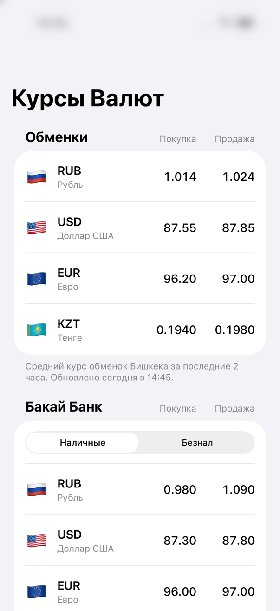
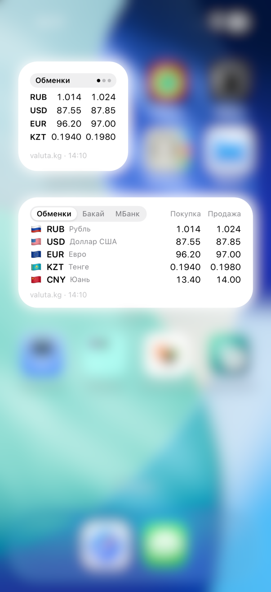

# Курсы Валют

<p align="center">
  
  &nbsp;&nbsp;
  
</p>

Приложение для iPhone с виджетом. Показывает курс рубля, доллара, евро, тенге и юаня к сому: в обменках Бишкека, в Бакай Банке и в МБанке. Курсы обновляются раз в час.

В виджете источник переключается прямо на домашнем экране, а наличный или безналичный курс банков выбирается в настройках виджета. Есть тёмная тема.

## Откуда курсы

- **Обменки** - [valuta.kg](https://valuta.kg/), средний курс обменок Бишкека за последние 2 часа. Если сайт недоступен, берётся курс Моссовета с [akchabar.kg](https://www.akchabar.kg/ru/currency-rate).
- **Бакай Банк** - [bakai.kg](https://bakai.kg/), курс головного отделения.
- **МБанк** - [mbank.kg](https://mbank.kg/), курс головного офиса.

## Установка

Приложения нет в App Store, ставится на телефон по проводу из Xcode.

1. Скопировать `Config/Local.xcconfig.example` в `Config/Local.xcconfig` и вписать свой Team ID (Xcode > Settings > Accounts).
2. Открыть `ExchangeRate.xcodeproj`, подключить iPhone и нажать Run.
3. На телефоне разрешить запуск: в Настройках найти поиском "Управление устройством" и нажать "Доверять" у своего Apple ID. Если раздела нет, сначала включить "Режим разработчика".

С бесплатным Apple ID приложение работает 7 дней, потом нужно ещё раз нажать Run в Xcode.

## Разработка

Логика и парсеры лежат в пакете `Packages/RatesKit`, их можно проверить без Xcode:

```bash
cd Packages/RatesKit
```

```bash
swift test
```

```bash
swift run rates
```

Последняя команда печатает текущие курсы всех источников в терминал.
